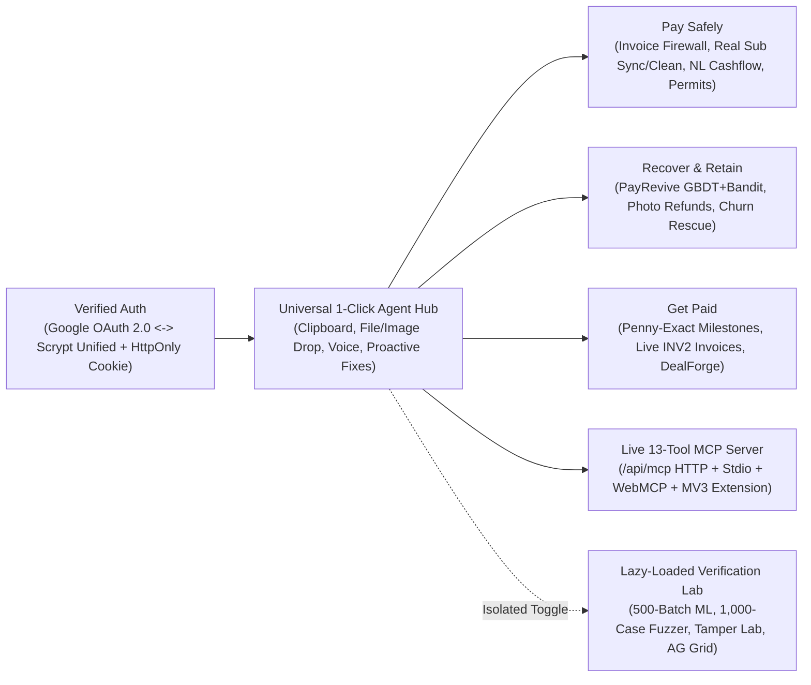

<div align="center">


# AegisPay v3.2

### Zero-Trust Agentic AI Financial Safety, Subscription Guard, Revenue Recovery & Milestone Billing OS on PayPal

[](./LICENSE)
[](https://aegispay-orpin.vercel.app)
[](https://developer.paypal.com)
[-CCFF00?style=flat-square&labelColor=050507)](./mcp-server/index.mjs)
[](./shared/payrevive.ts)
[](https://github.com/A-P-S-Bhaidav/AegisPay/actions/workflows/ci.yml)
[](./tests)

**[Live Production App](https://aegispay-orpin.vercel.app)** · **[Master Setup & Deployment Guide](./MASTER_GUIDE.md)** · **[System Architecture](./docs/SYSTEM_ARCHITECTURE.md)** · **[Verification Report](./docs/VERIFICATION.md)** · **[Postman Collection v2.1](./postman/AegisPay_Collection.json)** · **[Chrome Extension MV3](./CHROMEWEBSTORE.md)** · **[Submission Materials](./submission/README.md)**

</div>

---

> **"Agentic AI Proposes. Deterministic Code Decides. PayPal Moves the Money."**

**AegisPay v3.2** is a full-stack **Zero-Trust Agentic AI Commerce & Financial Safety Operating System** built on the **PayPal REST API Platform** (`Orders v2`, `Invoicing v2`, `Billing Subscriptions v1`, `Captures/Refunds v2`, `Vault v3 Setup Tokens`, `Transaction Search v1`, and `Webhooks v1`), **Multimodal Google Gemini 2.5 Flash** (with automatic **Groq Cloud LPU Llama-3.3-70B** failover), a **13-Tool Model Context Protocol (MCP) Server**, and a **Manifest V3 Chrome Extension**.

Untrusted text, screenshots, bank statements, and webpages are parsed by multimodal AI agents, while **100% of monetary bounds, spending permits, discount ladders, recipient bindings, and penny-exact splits are enforced by deterministic, cryptographically verified TypeScript code** before any PayPal API call can execute.

---

## 1. Three-Tier Zero-Trust Agentic Architecture


| Execution Tier | Primary Components | Architectural Responsibility | Security Invariant |
| :--- | :--- | :--- | :--- |
| **Tier 01: Agentic AI & ML Mesh** | Multimodal Google Gemini 2.5 (`Primary`) + Groq Cloud LPU (`Failover`) + Universal Device Ingest Agent + **Trained 16-Tree Newton GBDT + Exact TreeSHAP** | 1-click clipboard/file/screenshot/voice ingestion, invoice scam semantics, natural-language cashflow & subscription parsing, multi-agent negotiation, vision defect grading, milestone SOW decomposition, and failed-payment root-cause diagnosis. | **Zero Direct Pricing Authority**: AI/ML outputs feed deterministic bounds, Net-EV checks, and compliance gates. |
| **Tier 02: Deterministic Security Kernel** | [`shared/kernel.ts`](./shared/kernel.ts) & [`shared/payrevive.ts`](./shared/payrevive.ts) | Monotonic permit evaluation (`ALLOW / HOLD / BLOCK`), number-grounding verification (`verifyGroundedNumbers`), single-use HMAC-SHA256 review tokens, ZOPA mandate clamping, Hamilton Largest-Remainder penny-exact splits (`allocatePennyExact`), Disjoint LinUCB contextual bandit, and hard dunning compliance gates. | **Monotonic & Compliant**: AI can tighten (`ALLOW -> HOLD -> BLOCK`), never loosen. `0` compliance violations across 500-batch and 1,000-case suites. |
| **Tier 03: Atomic PayPal Settlement** | [`server/paypal.ts`](./server/paypal.ts) + PayPal JS SDK + Per-Tenant Isolation | PayPal OAuth2, Orders v2 (`CAPTURE` & `AUTHORIZE`), Vault v3 Setup Tokens, Invoicing v2 (`INV2-...`), Subscriptions v1 (`I-...` create, sync & cancel), Partial Refunds, and Verified Webhooks. | **Idempotent & Honest Settlement**: Binds tenant, recipient, currency, and amount before checkout; tracks exact settlement stage (`LIVE_PAYER_APPROVAL_READY` vs `LIVE_BUYER_CAPTURED`). |

### Product Workspace vs. Isolated Verification Lab

AegisPay strictly separates the everyday customer and merchant product from engineering benchmarks and adversarial test harnesses:

1. **Clean Customer & Merchant Workspace (`Overview`, `Pay Safely`, `Recover & Retain`, `Get Paid`)**:
   - Plain-English **Midnight Black (`#050507`) + Electric Cobalt (`#0047FF`) + Acid Lime (`#CCFF00`)** interface with a persistent **Universal 1-Click Agentic Command Bar** (`src/components/AgenticCommandHub.tsx`).
   - Includes a **First-Signup-Only 5-Step Interactive Guided Tour** (`src/components/InteractiveTour.tsx`) that automatically launches only when a user creates a new account (`isNewAccount === true`) and never nags returning users on subsequent sign-ins (while remaining replayable anytime via the header `Guided Tour` button).
2. **Lazy-Loaded Verification Lab (`src/components/DiagnosticsLab.tsx`)**:
   - Code-split via `React.lazy` so `AG Grid` and benchmark tooling never bloat the customer entry bundle.
   - Houses the **500-Batch PayRevive Simulation**, **Held-Out GBDT Model Card & TreeSHAP Waterfall**, **1,000-Case Property-Based Safety Fuzzer**, **5-Scenario Checkout Tamper Lab**, **Gemini-to-Groq HTTP 429 Failover Tester**, **AG Grid Cryptographic Audit Ledger** (CSV + Elastic NDJSON export), and **`PRINCIPAL_ARCHITECT` Admin RBAC Controls**.

---

## 2. Universal Agentic Device Integration & Core Workflows



### 1. Universal 1-Click Agentic Command Hub (`src/components/AgenticCommandHub.tsx`)
* **1-Click Clipboard Scan (`navigator.clipboard.readText()`)**: Reads any copied invoice, suspicious payment email, CSV bank statement, affordability question, failed payment log, or project brief from the user's device, automatically classifies intent across 9 workflows (`POST /api/agent/ingest`), executes the matching engine, and navigates directly to the result.
* **1-Click Device File & Screenshot Drop/Picker**: Drag-and-drop or select any `.eml`, `.csv`, `.json`, `.txt`, `.pdf`, `.png`, or `.jpg` file from your computer for zero-typing multimodal execution.
* **Voice Command Dictation (`SpeechRecognition`)**: Speak any natural-language financial question or command directly into the workspace bar.
* **Proactive Agentic Next-Best-Action Recommendations (`GET /api/agent/suggestions`)**: Continuously inspects workspace state and surfaces 1-click autonomous actions (e.g., auto-cleaning flagged subscriptions, syncing agent spending caps to free cashflow, or recovering high-EV failed payments).

### 2. Pay Safely: Invoice Firewall, Real Subscription Cleanup, NL Cashflow & Agent Permits (`src/components/PaySafelyView.tsx`)
* **Invoice & Payment Link Safety Scanner (`POST /api/scamshield/review`)**:
  * Scans pasted invoices, screenshots, and live PayPal `INV2-...` links (`USD`, `EUR`, `GBP`, `INR`) using **18 deterministic heuristic & prompt-injection rules** (`PI-001..003`, `SCAM-001..015`) fused monotonically with **Multimodal Gemini 2.5 / Groq** semantic analysis.
  * Mints a **5-minute single-use HMAC-SHA256 review token** binding the exact `amountCents`, `currency`, `payeeIdentifier`, and `tenantId` before unlocking **PayPal Smart Payment Buttons** (`Orders v2`). Blocks amount mutation, payee swaps, signature forgery, expired tokens, and replay attacks.
* **Real Subscription & Autopay Cleanup (`POST /api/lupa/subscriptions/*`)**:
  * **Sync PayPal Sandbox (`POST /api/lupa/subscriptions/sync-paypal`)**: Queries live PayPal Sandbox subscriptions (`/v1/billing/subscriptions`) and recurring transactions (`/v1/reporting/transactions`), provisioning a live PayPal Sandbox subscription (`I-...`) if none exists yet.
  * **Create Live PayPal Subscription (`POST /api/lupa/create-sandbox-subscription`)**: Creates a live PayPal Catalog Product $\rightarrow$ Billing Plan $\rightarrow$ Subscription (`/v1/billing/subscriptions`) with an approval link.
  * **Import Real Bank/PayPal Statements or Screenshots (`POST /api/lupa/subscriptions/add`)**: Parses pasted CSVs, statement text, or uploaded billing screenshots via `parseSubscriptionsFromInput` and updates cashflow commitments automatically.
  * **1-Click Auto-Clean All Flagged (`POST /api/lupa/subscriptions/clean-all`)**: Batch-cancels dormant/unused subscriptions (calling `POST /v1/billing/subscriptions/{id}/cancel` for live `I-...` agreements) and tightens over-provisioned billing caps to `110%` of the trailing average charge.
* **Realistic Natural-Language "Can I Afford This Purchase?" (`POST /api/lupa/cashflow-natural`)**:
  * Parses free-form affordability questions—including inline updates to checking balance, safety buffer, upcoming bills, and multi-unit purchases (e.g., *"Can I afford 3 studio monitors at \$450 each if my checking balance is \$6,200, safety buffer is \$500, and my \$1,900 rent is due in 5 days?"*).
  * Includes an **Interactive Financial Profile Editor** (`POST /api/lupa/cashflow-update`) to edit checking balance, safety buffer, and upcoming bills/savings goals, plus a **Pre/Post-Purchase Cashflow Waterfall**, **PayPal Pay-in-4 Installment Simulation**, and **1-Click Sync to AI Spending Permit Cap**.
* **Monotonic AI Spending Permits & PayPal Vault v3 (`POST /api/lupa/agent-pay`)**:
  * Compiles plain-English spending rules with deterministic number-grounding verification (`verifyGroundedNumbers`), mints **PayPal Vault v3 Setup Tokens**, executes `intent: "CAPTURE"` on `ALLOW`, places uncertain purchases into a real **PayPal Authorization Hold (`intent: "AUTHORIZE"`)** on `HOLD`, and rejects policy violations on `BLOCK`.

### 3. Recover & Retain: Open-Ended Natural-Language Revenue Recovery (`src/components/MerchantRecoveryView.tsx`)
* **PayRevive Failed-Payment Recovery (`shared/payrevive.ts` & `POST /api/payrevive/recover`)**:
  * Accepts **any open-ended natural-language description** (`parseNaturalFailedPayment`) or full custom telemetry inputs (`amountCents`, `declineCode`, `daysUntilPayday`, `hasPayPalBackupWallet`, `accountTenureMonths`, `historicalSuccessRate`).
  * **Trained 16-Tree Second-Order Newton GBDT + Exact TreeSHAP**: Trained via `npm run train:payrevive` on `N=12,000` labeled records and evaluated on an untouched `N=3,000` held-out split (`ROC-AUC: 0.8301`, `Brier Score: 0.1403`) with exact path-dependent TreeSHAP attributions (`additivityDelta < 1e-6`).
  * **Disjoint LinUCB Contextual Bandit (`Sherman-Morrison` Ridge Updates)**: Selects the highest Expected Net Value recovery action across Orders v2 Jitter Retries, Payday Smart Retries, PayPal Backup Funding Links (`INV2-...`), and Split Two-Part Invoices—updating bandit weights only after verified PayPal settlement (`POST /api/payrevive/confirm-settlement`).
  * **Hard Deterministic Compliance Gate**: Blocks retries and outreach on stolen/revoked hard declines, `>=3` retries in 30 days, open PayPal disputes, TCPA/GDPR opt-outs, and quiet hours (`21:00–07:59`).
* **ClipRefund Keep-The-Item Photo Refunds (`POST /api/cliprefund/evaluate-and-refund`)**:
  * Accepts **any open-ended natural-language damage claim** (`parseNaturalDamageClaim`), uploaded device photos, and customizable merchant refund policy rules (`returnShippingCostCents`, `restockingLossPct`, `maxKeepItemOrderCents`).
  * Enforces non-monetary Vision telemetry schemas, blocks duplicate photo SHA-256 replays, and executes **PayPal Partial Refunds (`POST /v2/payments/captures/{id}/refund`)** on verified owned captures.
* **ChurnRescue Subscriber Retention (`POST /api/churnrescue/intercept`)**:
  * Accepts **any open-ended natural-language subscriber cancellation story** (`parseNaturalChurnContext`) or custom plan/usage parameters.
  * Enforces a strict `20% -> 35% -> 50%` concession ladder, blocks `>=60%` active-usage discount gaming, trips a `0%` circuit breaker on legal/chargeback threats with human support escalation, and prevents duplicate concessions via atomic row locking.

### 4. Get Paid: Milestone Billing & Multi-Agent Deal Negotiation (`src/components/GetPaidView.tsx`)
* **PayStream Penny-Exact Milestone Billing (`POST /api/paystream/create-plan`)**:
  * Accepts **any open-ended natural-language project brief & team split** (`parseNaturalProjectBrief`) or dynamic multi-collaborator rows.
  * Uses **Hamilton's Largest-Remainder algorithm (`allocatePennyExact`)** to guarantee `sum(milestones) === totalBudgetCents` and `sum(collaboratorSplits) === milestone.amountCents` with **zero floating-point drift**, issues live **PayPal Sandbox Invoices (`INV2-...`)**, and verifies deliverable proof links/notes.
* **DealForge Multi-Agent Quote Negotiation (`POST /api/dealforge/negotiate`)**:
  * Accepts **any open-ended natural-language vendor quote & buyer mandate** (`parseNaturalDealMandate`) or custom ceiling/floor/SLA inputs.
  * Runs a multi-round Buyer-Agent vs. Seller-Agent negotiation clamped strictly within confidential ZOPA boundaries, neutralizes adversarial prompt injection, signs a **SHA-256 Deal Contract**, and settles via **PayPal Orders v2** (upfront deposit) + **PayPal Invoicing v2** (completion milestone).

---

## 3. Live 13-Tool MCP Server & Manifest V3 Chrome Extension

### 1. Triple-Transport Model Context Protocol (MCP) Server (`13 Tools`)
AegisPay exposes all 13 financial safety and commerce tools across **three active MCP transports**:
1. **Live HTTP JSON-RPC 2.0 MCP Endpoint (`GET /api/mcp` & `POST /api/mcp`)**:
   - Always online on both `http://localhost:8787/api/mcp` and `https://aegispay-orpin.vercel.app/api/mcp`.
   - Includes an **In-App Interactive MCP Inspector & Tool Runner** modal (`MCP Server: 13 Tools Online` button in the top navigation bar) to execute `initialize`, `tools/list`, and `tools/call` live in the browser.
2. **Stdio CLI MCP Server (`mcp-server/index.mjs`)**:
   - Run `npm run mcp` or connect **Claude Desktop**, **Cursor**, **Windsurf**, or **Antigravity** using the ready-to-copy `claude_desktop_config.json` snippet in the MCP modal.
3. **In-Page WebMCP Bridge (`src/webmcp.ts`)**:
   - Registers `window.aegisPayMcp.listTools()` / `window.aegisPayMcp.callTool(name, args)` and `navigator.modelContext` for browser-resident agents.

| MCP Tool Name | Workflow / Capability |
| :--- | :--- |
| `aegispay_universal_ingest` | Auto-detects intent from any raw text, CSV, email, or screenshot and executes the matching AegisPay workflow |
| `aegispay_check_cashflow` | Evaluates natural-language or structured purchase affordability against free cashflow and upcoming bills |
| `aegispay_audit_subscriptions` | Audits, imports, syncs PayPal Sandbox subscriptions, or batch-cleans all flagged recurring agreements |
| `aegispay_compile_spending_rule` | Compiles plain-English spending rules into grounded numeric limits (`verifyGroundedNumbers`) |
| `aegispay_list_permits` | Lists active AI agent spending permits and remaining daily/single-order caps |
| `aegispay_agent_pay` | Evaluates an agent purchase against monotonic policy and executes PayPal `CAPTURE` or `AUTHORIZE` |
| `aegispay_scamshield_review` | Scans invoice text for fraud/prompt injection and issues a single-use HMAC-SHA256 review token |
| `aegispay_scamshield_verify_capture` | Verifies and consumes a single-use ScamShield token before PayPal order capture |
| `aegispay_payrevive_recover` | Runs Newton GBDT + TreeSHAP + LinUCB Bandit + Compliance Gate on a failed payment |
| `aegispay_dealforge_negotiate` | Runs multi-agent ZOPA negotiation and signs a SHA-256 contract with PayPal deposit/invoice settlement |
| `aegispay_cliprefund_evaluate` | Grades item damage telemetry against merchant policy and issues a PayPal partial refund |
| `aegispay_churnrescue_intercept` | Evaluates subscriber retention concessions under the `20% -> 35% -> 50%` ladder and circuit breakers |
| `aegispay_paystream_create_plan` / `aegispay_paystream_issue_invoice` | Generates penny-exact milestone plans and sends live PayPal Sandbox Invoices (`INV2-...`) |

### 2. Manifest V3 Chrome Extension (`extension/` & `/api/download/extension`)
* **Guaranteed 1-Click Browser Download**: Click **Browser Extension** in the top navigation bar (or visit `/api/download/extension`) to download `aegispay-chrome-extension-mv3.zip`, backed by both static assets and embedded binary fallback (`server/embeddedAssets.ts`).
* **How to Load in Chrome / Brave / Edge**:
  1. Unzip `aegispay-chrome-extension-mv3.zip` (or select the repo's `extension/` directory directly).
  2. Open `chrome://extensions`, toggle **Developer mode** ON, click **Load unpacked**, and select the folder.
  3. Open the **AegisPay Side Panel** on any webpage and click **1-Click Scan Active Webpage DOM** (or right-click any selected text) to scan invoices and launch verified PayPal checkout.
* **In-App Live Side-Panel Companion**: Inside the **Browser Extension** modal in the web app, you can also test the interactive extension side panel immediately without installing anything.

---

## 4. OWASP Zero-Trust Security & Bidirectional Identity Unification

* **Bidirectional Google OAuth 2.0 $\leftrightarrow$ Email/Password Unification (`server/store.ts`, `server/index.ts`)**:
  * **Google OAuth 2.0**: Server-side authorization code exchange + `oauth2.googleapis.com/tokeninfo` verification (`aud === GOOGLE_CLIENT_ID`, `email_verified === true`) protected by a signed 10-minute `aegis_oauth_state` CSRF cookie.
  * **Scrypt Email Authentication**: `crypto.scryptSync` (`N=16384, r=8, p=1`, 16B random salt, `timingSafeEqual`) for email accounts.
  * **Seamless Account Linking**: If a user registers via Google OAuth first and later signs up or signs in with Email + Password using the same email address (or vice versa), AegisPay automatically links both authentication methods to the same `UserRecord` and `TenantWorkspace` without losing any data.
  * **First-Signup-Only Guided Tour**: `/api/auth/register` and `/api/auth/google/callback` return `isNewAccount: true` only on initial account creation so the 5-step interactive tutorial never repeats on subsequent sign-ins.
* **Strict CORS, CSRF, SSRF, CSP & Webhook Verification (`server/security.ts`)**:
  * Enforces `HttpOnly; SameSite=Strict` session cookies, Origin Allowlist CORS, cookie CSRF header/origin verification (`X-Requested-With: AegisPay-Client`), strict `Content-Security-Policy`, SSRF blocking (`validateSafeExternalUrl` rejects loopback, RFC1918 private IPs, and `169.254.169.254`), 3-tier sliding-window rate limiting (`AUTH`, `MUTATION`, `READ`), and constant-time HMAC webhook verification (`POST /api/paypal/webhook`).

---

## 5. Quickstart & Verification

### Run Locally

Use Node.js `22.12+` (22 LTS) or Node.js `24 LTS`:

```bash
git clone https://github.com/A-P-S-Bhaidav/AegisPay.git
cd AegisPay
npm ci
cp .env.example .env
```

Configure your PayPal Sandbox (`PAYPAL_CLIENT_ID`, `PAYPAL_CLIENT_SECRET`, `PAYPAL_ENV=sandbox`), AI provider keys (`GEMINI_API_KEY` and/or `GROQ_API_KEY`), and a 32-byte signing secret in `.env`:

```bash
node -e "console.log(require('crypto').randomBytes(32).toString('hex'))"
# Paste output into AEGIS_KERNEL_SECRET in .env
```

Start the server:

```bash
npm run check
npm start
```

Open **[http://localhost:8787](http://localhost:8787)**. Create an account to use live configured providers, or use a PayPal Sandbox personal buyer account (distinct from the sandbox business merchant) to approve checkouts.

### Automated Verification (`359 Vitest + 6 real-browser tests`)

| Tier | Location | Count | What it proves |
| :--- | :--- | :--- | :--- |
| Unit | `tests/kernel.test.ts` | 265 | Deterministic kernel: money math, permits, tokens, PayRevive, fuzzers |
| Integration | `tests/api.test.ts`, `tests/mcp.test.ts`, `tests/contract.test.ts` | 87 | Real HTTP server, auth, tenancy, MCP JSON-RPC, client-to-server route contract |
| API end-to-end | `tests/e2e.test.ts` | 7 | Full user journeys over HTTP |
| Browser end-to-end | `tests/browser/journey.spec.ts` (Playwright, Chromium) | 6 | Real UI: landing, workspace, session persistence, agent routing, compulsory photo gate, extension download |
| Post-deploy smoke | `scripts/smoke.mjs` | 8 checks | Live deployment health, session, MCP tools, agent routing, refund photo gate |

```bash
npm run typecheck           # Strict TypeScript, zero errors
npm test                    # All 359 Vitest tests (unit + integration + API e2e)
npm run test:coverage       # Same, with v8 coverage and regression thresholds
npm run test:e2e            # Playwright real-browser journeys (npx playwright install chromium first)
npm run ci                  # typecheck, coverage, build, browser e2e: the exact CI gate
node scripts/smoke.mjs https://aegispay-orpin.vercel.app   # Smoke-test any deployment
npm run build               # Packages extension.zip, bundles serverless API, and builds Vite production bundle
npm run benchmark:payrevive # Runs reproducible 500-batch (10,000-payment) synthetic PayRevive benchmark
npm run verify:providers    # Opt-in live PayPal Sandbox + Gemini/Groq provider verification
```

Measured coverage of `server/` and `shared/`: about 81% statements, 66% branches, 95% functions. Thresholds in `vitest.config.ts` fail CI if it regresses.

### CI/CD

* **CI** (`.github/workflows/ci.yml`, on every push and pull request): typecheck and coverage, production build with extension ZIP and MV3 manifest validation, Playwright browser E2E, and a production-dependency `npm audit` gate.
* **CD**: Vercel's Git integration deploys every push to `main` to production. `.github/workflows/post-deploy-smoke.yml` runs `scripts/smoke.mjs` against each successful production deployment.
* **Known limits**: voice input uses the browser Web Speech API and is not exercised headlessly; the Chrome extension is validated structurally (manifest and ZIP) rather than loaded into a live Chrome profile in CI; only Chromium is covered.


---

## 6. Data Architecture, Honesty & Deployment Notes

* **Server-Only Secrets & Local Storage**: API keys and secrets remain strictly on the server and are never exposed in client bundles. Local account and workspace data is stored in a permission-restricted JSON file under `data/aegispay_store.json` (`0o600`, git-ignored).
* **Honest Settlement & Sandbox Scope**:
  * Payment request review binds `amountCents`, `currency`, `payeeIdentifier`, and `tenantId` before order creation; buyer approval on PayPal and server-side capture complete checkout.
  * Cashflow checks evaluate the balance, safety buffer, and commitments configured or imported by the account owner without requiring direct bank login credentials.
  * PayRevive's 16-tree Newton GBDT is trained on generated payment telemetry (`npm run train:payrevive`); its held-out metrics and 500-batch recovery lift are reproducible engineering benchmarks (`docs/VERIFICATION.md`), and recovery links only count as settled after separate settlement verification.
  * Milestone plans use integer cents (`allocatePennyExact`); PayPal invoices request payment from clients and do not act as a licensed money transmitter or regulated escrow custodian.
  * Vercel's temporary filesystem (`/tmp`) and process memory are designed for sandbox demonstrations; production financial deployments across multiple serverless instances should back `server/store.ts` with a durable shared transactional database (e.g., PostgreSQL / Redis).

---

## License

Distributed under the **[MIT License](./LICENSE)**. Third-party dependencies retain their respective licenses.
