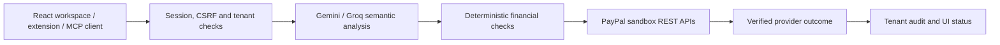

# AegisPay architecture

## Request path

A React application calls an Express API. Email/password or verified Google identity establishes a tenant session. The API provides AI providers with untrusted task text or images, applies deterministic financial rules, and calls the configured PayPal sandbox REST app.

## Authority and settlement

- AI suggestions cannot increase a signed spending limit or loosen a deterministic hold/block decision.
- Scam review tokens bind tenant, amount, currency and recipient. Checkout creation and capture validate ownership and authorization.
- A PayPal order is initially awaiting approval. Only provider-confirmed capture establishes captured funds. An invoice, approval URL, policy decision, or model prediction is not a settlement.
- Refunds require an owned capture and enforce the remaining refundable amount. Image replay reservations and provider failure handling prevent duplicate or falsely reported refunds.
- A learning feedback boolean from a client cannot establish settlement.
- Webhook ownership is derived from stored provider-resource ownership, never an untrusted `ownerTenantId` in the event body.

## AI and recovery model

`server/gemini.ts` implements structured semantic analysis, model routing, provider timeouts, and secondary-provider handling. Provider/model execution telemetry must describe the call that actually succeeded. Production operations fail when the required provider is unavailable. The optional practice tenant uses a separate keyless engine.

`shared/payrevive.ts` evaluates recovery actions with deterministic restrictions and expected-value calculations. `scripts/train-payrevive-gbdt.ts` fits a custom 16-tree second-order Newton gradient-boosted tree model on generated data. Its held-out test split is also generated. This is an experimental policy model; it has no demonstrated calibration on actual merchant declines. The reproducible 500-batch benchmark and TreeSHAP additivity checks are test evidence, not measured revenue lift or a regulatory compliance certification.

`shared/kernel.ts` contains exact-cent allocation, signed permits, number grounding, conservative verdict combination, and related invariants. Tests include adversarial review-token changes and replay/concurrent operation cases. Their scope is recorded in the verification report.

## Interfaces

- The customer workspace contains payment protection, recovery, retention, refunds and milestone billing.
- The lazy-loaded Verification Lab contains AG Grid audit records and test harnesses. AG Grid is an actual dependency; exporting Elastic-compatible NDJSON does not itself constitute an Elastic service integration.
- The stdio MCP adapter and authenticated HTTP MCP endpoint expose workflow tools. WebMCP provides browser-local access through the signed-in application session.
- The Manifest V3 extension uses explicit account sign-in, endpoint-bound session tokens, `activeTab`, and two allowlisted API origins. Its worker sends selected text only to the selected endpoint, without automatic remote failover.

## Storage and deployment boundaries

`server/store.ts` stores account and workspace state as permission-restricted plaintext JSON with coalesced atomic file replacement. It includes an app-scoped snapshot of PayPal order, invoice, subscription, vault token and verified webhook records. Single-instance restarts can restore those records from the same file. In-flight requests and replay caches have process-local lifetime.

Vercel's temporary filesystem and multiple function instances cannot provide durable shared payment ownership, revocation or exactly-once accounting with this architecture. Production funds require a shared durable transaction store and atomic operations. Restrict deployment to sandbox evaluation until that work is complete. A persistent single-process deployment reduces some restart risks but is not equivalent to distributed financial correctness.

The supplied Render and Docker configuration is deployment scaffolding. Actual hosting and persistent-storage provisioning must be verified separately. Google OAuth requires valid registered redirects; PayPal webhook verification requires a configured webhook ID and real sandbox event delivery.
